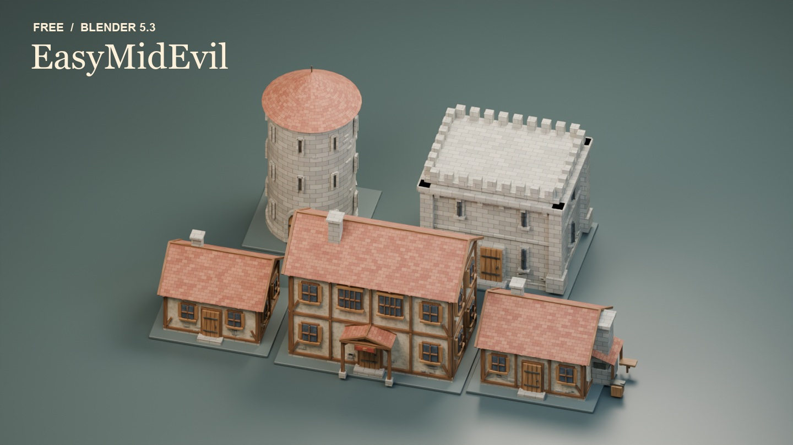
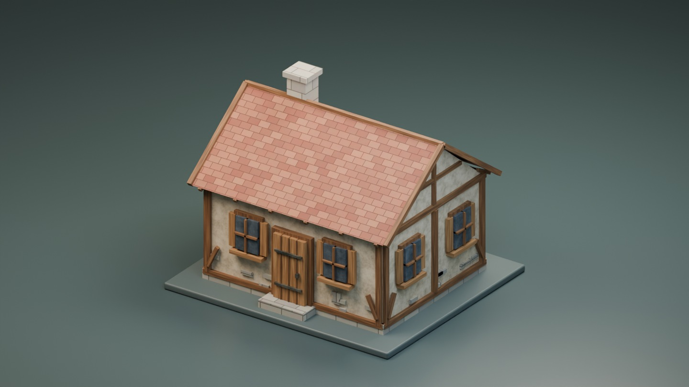
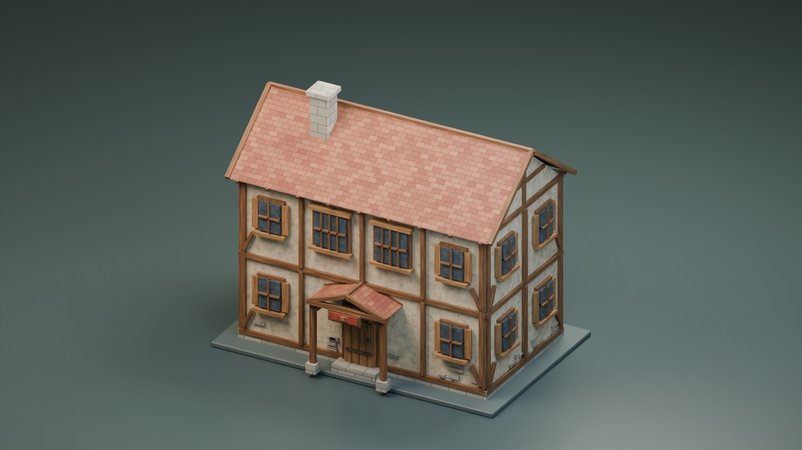
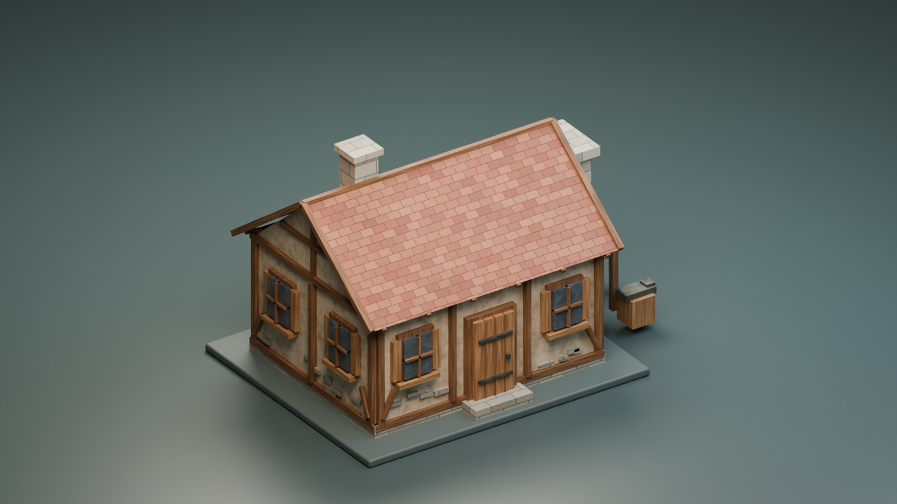
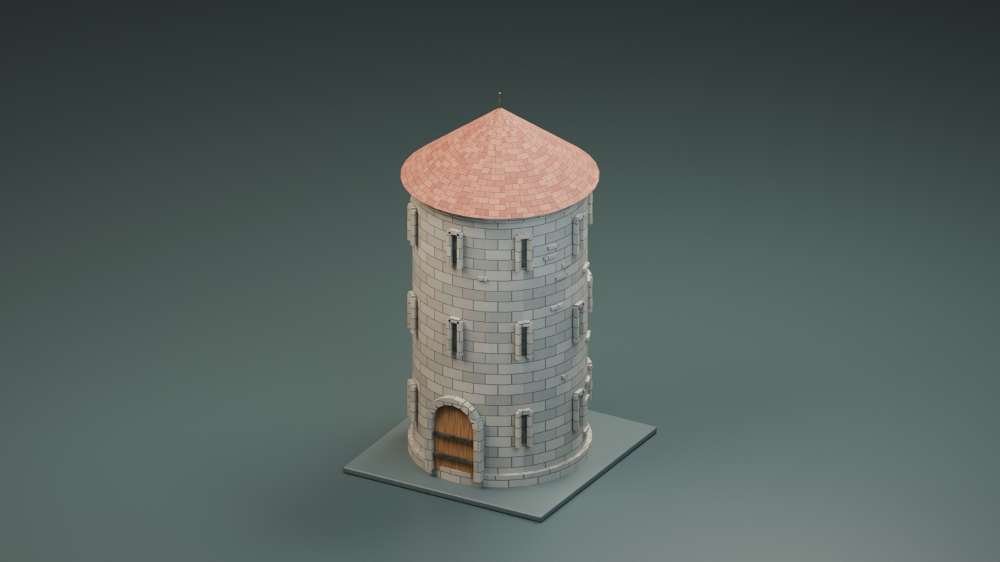
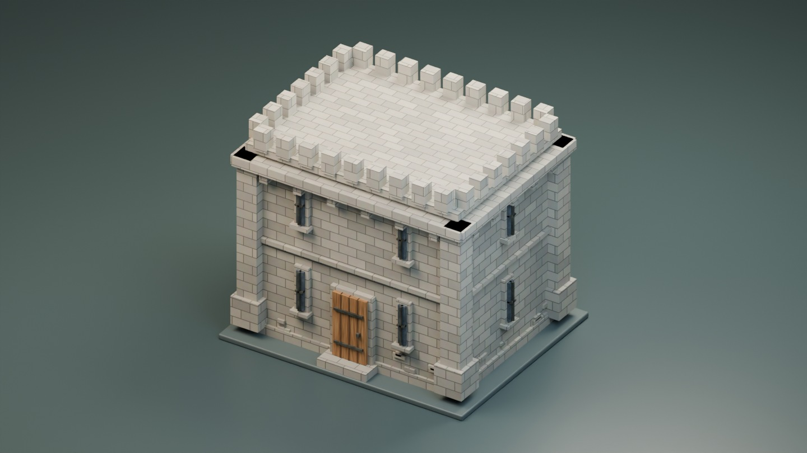

# EasyMidEvil

Make medieval buildings in Blender without modeling each one from scratch. Choose a **cottage, tavern, blacksmith, round tower, or castle keep**, then adjust the building while you look at it in the viewport.

**Free · Blender 5.3 · [Download v0.2.0](./EasyMidEvil-0.2.0.zip) · [Watch the showcase](./media/showcase.mp4)**

## Gallery

| Cottage | Tavern | Blacksmith |
| :---: | :---: | :---: |
|  |  |  |

| Round tower | Castle keep |
| :---: | :---: |
|  |  |

## Get started

1. Download **EasyMidEvil-0.2.0.zip**. Leave it zipped.
2. In Blender 5.3, open **Edit → Preferences → Get Extensions → menu → Install from Disk** and choose the ZIP.
3. In the 3D Viewport, press **N** and open **EasyMidEvil**. Choose a preset and click **Create Building**, or use **Create Starter Village** for all five.
4. In Object Mode, select a building or one of its parts to adjust its width, depth, floors, variation, or details. Make final mesh edits after you settle on the sliders.

These are exterior models: doors and windows are decorative, and there are no interiors. The studio lighting and plinths are for the showcase and aren't included in the add-on.

[Source code](source/easymidevil) · [GPL-3.0-or-later](LICENSE)
